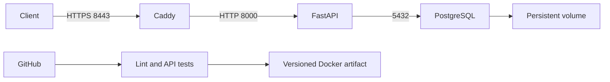

# School attendance deployment

A synthetic student, class and attendance API with Docker deployment and CI.

## Local deployment

Install Docker and start its engine. Copy .env.example to .env and replace every token and password with distinct random values (use hexadecimal passwords to avoid URL escaping). Run:

```sh
docker compose up --build -d
curl -k https://localhost:8443/ready
```

The local proxy uses an internal certificate authority. For browser trust, export and trust Caddy's local root certificate. The curl -k option is only for this local demonstration. API documentation is at https://localhost:8443/docs. Use bearer tokens from your local .env. Teacher 1 owns class 1, teacher 2 owns class 2, and the student token has no write permission.

Only localhost port 8443 is published. The API uses internal port 8000 and PostgreSQL uses internal port 5432. Data persists in the Compose data volume. All records are synthetic.

## Architecture



## Verification

Run pytest -q and ruff check app tests after installing requirements.txt. CI builds an image tagged with the Git commit and uploads its compressed archive. Download the archive and use docker load to deploy the same artifact.

Tests cover unauthorized writes, teacher assignment, student membership and duplicate prevention. Database uniqueness handles simultaneous duplicate writes. Attendance and its audit record commit in one transaction.

## Operations

See docs/runbook.md. Keep evidence in docs/evidence and link it below before submission.

## Submission evidence status

- Local API test output — pending verification.
- GitHub pipeline URL and final commit — pending repository publication.
- Container image tag/digest — pending Docker build.
- Deployment, failure/recovery and backup/restore screenshots — pending execution.
- Demo video — pending recording.

## Assumptions and limitations

Demo authentication uses long environment-provided bearer tokens whose hashes are stored in the database. Token rotation requires restarting the application. The database account owns its schema for this small local deployment. Separate migration and runtime database roles would improve production privileges. Schema creation uses startup SQL rather than a migration framework. CI tests currently use SQLite, so PostgreSQL deployment requires separate integration verification. TLS is local and the deployment is bound to localhost. Metrics are not implemented.

AI assistance was used to interpret the assignment and generate the initial implementation and documentation. The candidate must review, understand and validate the implementation and update this disclosure before submission.
